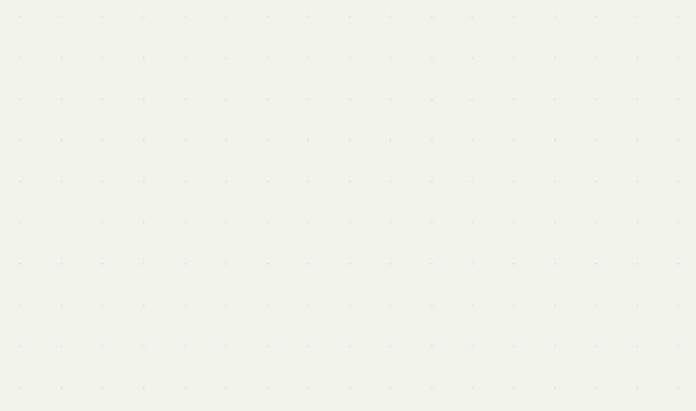

# Research Scout

<p align="center">
  
</p>

<p align="center"><em>From scattered evidence to a clearer research picture.</em></p>

Research Scout — 科研探索项目，正在起步。

### Animation

动画以散落的 `0`、`1`、`+`、`?` 等字符开始，逐渐向中央聚合，再逐行显现论文标题、正文和折线图，停留后循环播放。视觉与动画逻辑参考 [Autonomous Machine Learning Research](https://automlr.com/) 首页右侧的 “Research crystallization”。本仓库独立绘制动画，未打包原站代码或素材。

GitHub README 无法运行 Canvas / JavaScript，因此使用 GIF 展示同样的演变过程。[查看静态版本](assets/research-crystallization.png)。

### Regenerate

需要 Python 3、Pillow 和 DejaVu Sans Mono 字体（字体路径可在脚本中调整）。

```bash
python -m pip install -r requirements-animation.txt
python scripts/render_readme_animation.py
```

动画源文件：[scripts/render_readme_animation.py](scripts/render_readme_animation.py)。
