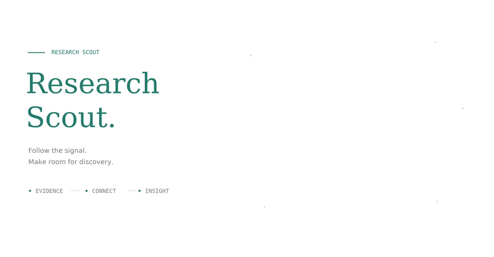

# Research Scout

<p align="center">
  
</p>

<p align="center"><em>From scattered evidence to a clearer research picture.</em></p>

Research Scout — 科研探索项目，正在起步。

### Animation

透明背景上的字符沿弧线汇聚为一张研究卡片，依次显现标题、正文和连续曲线。独立设计的构图采用蓝色与青绿色、圆角卡片和细腻阴影，以 25 fps 播放，每轮约 12 秒，平滑淡出后重新开始。动画概念参考 [Autonomous Machine Learning Research](https://automlr.com/) 首页右侧的 “Research crystallization”。本仓库独立绘制动画，未打包原站代码或素材。

README 使用支持完整 Alpha 透明度的动画 WebP，保留柔和边缘和顺滑的运动。[查看静态版本](assets/research-crystallization.png)。

### Regenerate

需要 Python 3、Pillow 和 DejaVu 字体（字体路径可在脚本中调整）。

```bash
python -m pip install -r requirements-animation.txt
python scripts/render_readme_animation.py
```

动画源文件：[scripts/render_readme_animation.py](scripts/render_readme_animation.py)。
